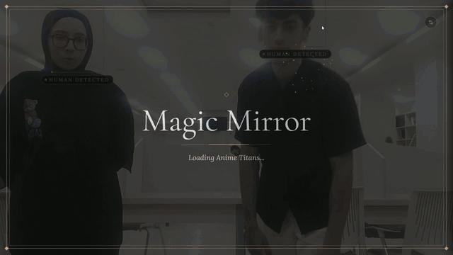
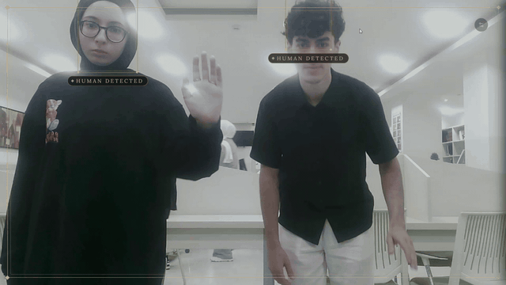
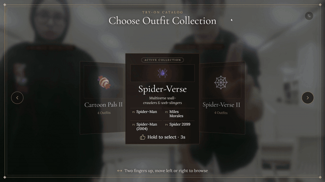
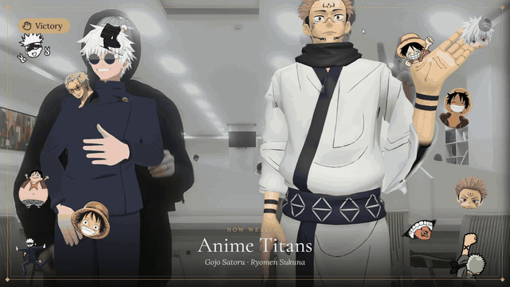
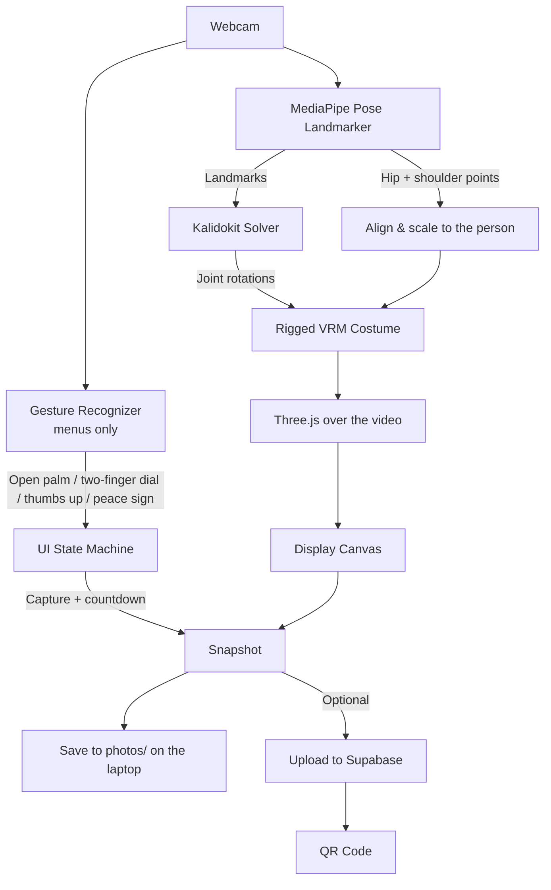
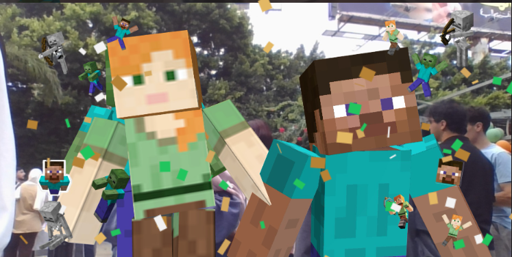
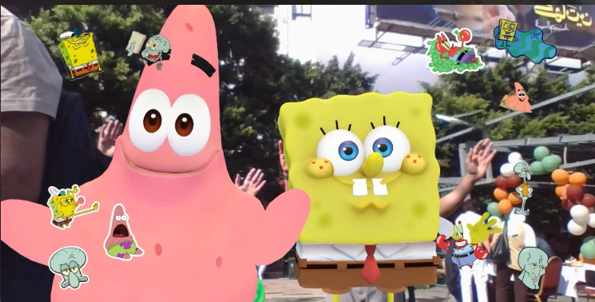

# AR Magic Mirror

Magic Mirror is an augmented-reality (AR) mirror that runs in a web browser. It tracks the full bodies of up to four people through a webcam and dresses each of them in a rigged 3D costume that moves with them in real time, over the live camera image. Menus and photos are controlled with hand gestures, and everything runs locally on the laptop, with no server and no internet connection needed.

<p align="center">
  
</p>

Made by **Hussein Mayladan** ([@HusseinMayla](https://github.com/HusseinMayla)) and **Nour Al Shami** ([@Nan0dev06](https://github.com/Nan0dev06)).

**Runs on:** any graphics card, at about 30 FPS even on an entry-level one · CPU only, at a lower frame rate · Chrome, OperaGX or edge · fully offline

---

## Why we built it

We wanted a mirror for events like school open days and AI fairs: you walk up, pick a costume with your hands, and see it on your whole body, live. We looked for an open-source project that already did this and couldn't find one. What we found was either flat 2D, needed a strong GPU, or sent the camera feed to a remote server. So we built our own from open-source building blocks, and we're sharing it so the next people who want this don't have to go through what we did.

<details>
<summary><b>The longer story</b></summary>

<br>

Our first plan was simple: take a photo, send it to an image-generation model, and show the result. It worked on paper, but it wasn't a mirror. It was a photo booth with a wait.

Before writing anything, we searched public repositories for a project that did the live version. None of them fit:

- Some were 2D overlays that paste a flat garment image onto the shoulders. They were light and fast, but not 3D.
- Some rebuilt a full 3D body from video and fitted real 3D clothes. They were impressive, but they needed a strong GPU, and the team behind one reported single-digit frame rates before cutting back to flat garment pieces.
- Some used heavy neural networks to parse clothing and generate the result. These were far too slow for a live mirror, and one was an unmaintained hackathon prototype.
- Some ran on a remote server, so the camera feed had to leave the machine.

None of them put live 3D costumes on people over the real camera image, with gesture control and photo capture, all inside the browser. So we stopped looking for something to fork and started combining open-source building blocks instead.

We flipped the plan. Instead of generating a picture after the fact, the mirror stays live and nothing leaves the machine: the camera stays on, each body is tracked frame by frame, and a 3D costume follows its joints.

The idea we bet on: you don't need to reconstruct a 3D body from video. Track a handful of joints, turn them into bone rotations with plain math, and hand those rotations to a pre-rigged 3D model. That's how VTuber avatars run smoothly, and it's cheap enough for an ordinary laptop.

</details>

## How it compares

What we found when we looked, next to what Magic Mirror does:

| | 2D overlays | 3D body reconstruction | AI-generated try-on | **Magic Mirror** |
| :--- | :--- | :--- | :--- | :--- |
| **What you wear** | A flat image on the shoulders | Real 3D clothes | A generated picture | A rigged 3D costume on the full body |
| **Speed** | Live | Slow without a strong GPU | Seconds per image | Live, about 30 FPS on an entry-level graphics card |
| **Hardware** | Any laptop | A strong GPU | A strong GPU or a remote server | An ordinary laptop, even CPU only |
| **Camera feed** | Stays local | Stays local | Often sent to a server | Stays local, works offline |
| **Gestures, photo and QR code** | No | No | No | Yes |

---

## How to use it

**1. Step in.** A gold "Human detected" frame appears around each face. While nobody has opened the menu yet, a hologram tutorial shows the first gesture.

**2. Open the menu.** Hold an open palm (a high five) close to the camera for 3 seconds.

<p align="center"></p>

**3. Browse and choose.** Hold your index and middle fingers up and move your hand left or right: each step moves one collection, however fast you move. Hold a thumbs up for 3 seconds to put the collection's costumes on, with its sticker sheet along the screen edges.

<p align="center"></p>

**4. Take a photo.** Hold a peace sign for 1 second. A 3-2-1 countdown, a flash and confetti follow, then the photo appears with a QR code to download it for 24 hours. A copy is also saved on the laptop, so no photo is lost when there's no internet or someone doesn't scan the code.

<p align="center"></p>

**5. Done.** Pressing Done resets the mirror for the next people. So does walking away: a mirror left empty for 10 seconds with a costume on goes back to the start.

Every gesture also has a mouse or keyboard fallback for staff: click the arrows and cards in the menu, press **M** to open or close the menu and **P** to take the photo. The gear icon (top right) opens the staff panel.

---

## What it does

- **Full-body tracking for up to 4 people.** MediaPipe Pose Landmarker (lite) finds 33 body points per person, and each person keeps their own costume as they move around.
- **Rigged 3D costumes.** 13 collections with up to 4 costumes each: Spider-Verse, Minecraft, Bikini Bottom, Sonic, Freddy's Pizzeria, Anime Titans and Cartoon Pals, most with a second set. The arms, hands, head and torso follow the body, including turning sideways.
- **Hand-gesture menus.** Open palm, a two-finger dial, thumbs up and peace sign, each with a visible hold timer so nothing triggers by surprise.
- **Photos, saved locally and shared by QR code.** The photo includes the costumes and the collection's stickers. Every photo is saved to a `photos/` folder on the laptop, even offline. If you connect a Supabase project, it is also uploaded and shown as a QR code whose link expires after 24 hours.
- **Works offline.** The MediaPipe models and engine, the fonts and the icons are all bundled. Only the QR code needs internet.
- **Built for a crowd.** Text is readable from 2–3 m, the idle screen teaches the first gesture, and the mirror resets itself when people walk away.
- **Self-healing.** If the camera or MediaPipe fails (for example, an unplugged webcam), it retries on its own and shows a staff alert until it recovers.
- **Staff panel.** FPS and per-stage timing, gesture thresholds, number of people, costume size and height, a ghost mode and a manual collection picker.

---

## Getting started

### Requirements

- [Node.js](https://nodejs.org/) 22.12 or newer (npm comes with it)
- Chrome or Edge with WebGL 2
- A webcam (720p or better)
- A GPU is recommended. Without one it still runs, at a lower frame rate.
- Optional: a free [Supabase](https://supabase.com/) project, for the photo QR codes

All JavaScript dependencies are listed in `package.json` and installed by `npm install`. There is nothing else to install.

### Run it

```bash
git clone https://github.com/HusseinMayla/ar-magic-mirror.git
cd ar-magic-mirror
npm install
npm run dev
```

Open http://localhost:5173 and allow the camera. For an event, switch the browser to full screen (F11).

`npm run build` type-checks and builds the app, and `npm run preview` serves the build (the photo upload works there too).

### Photos

Every photo is saved to the `photos/` folder in the project, named by date and time (for example `magic-mirror_2026-10-05_14-32-07_1a2b3c4d.jpg`). This works without internet and without any setup, and the folder is git-ignored so photos are never committed.

These are photos of your visitors, so delete them when you no longer need them. To keep no local copies at all, copy `.env.example` to `.env.local` and set `SAVE_PHOTOS_LOCALLY=false`.

### Photo QR codes (optional)

Without this step, the photo screen says the photo is saved and to ask a staff member for a copy, instead of showing a QR code. The same happens at an event with no internet: the upload gives up after 15 seconds, and the local copy is already saved.

1. Create a free project on [Supabase](https://supabase.com/).
2. In **Storage**, create a bucket named `photos` and leave **Public** off.
3. Copy `.env.example` to `.env.local` and fill in `SUPABASE_URL` and `SUPABASE_SERVICE_ROLE_KEY` (from **Project Settings → API**).
4. Restart `npm run dev`.

The secret key is only read by the local dev server and is never sent to the browser. Uploaded photos and their links expire after 24 hours, and expired uploads are deleted on the next upload (the local copies in `photos/` are kept). The upload endpoint has no login, so keep the dev server on `localhost` and don't expose it to a public network.

---

## Performance

| Hardware | Frame rate |
| :--- | :--- |
| Any graphics card, even an entry-level one | About 30 FPS |
| CPU only | Runs, at a lower frame rate |

If it runs slowly, open the staff panel and turn on **Downscale Inference (640w)**, or lower **Max People Tracked**. Turn on **Show Telemetry HUD** to see the FPS and where each frame's time goes.

---

## Add your own collection

1. Put your costumes in `public/assets/costumes/<your-folder>/`. Each one must be a humanoid VRM file. [VRoid Studio](https://vroid.com/en/studio) exports VRM directly, and other models can be rigged in Blender with the [VRM add-on](https://vrm-addon-for-blender.info/en/).
2. Optionally, add a 1920×1080 transparent PNG sticker sheet to `public/assets/stickers/`. Keep the stickers near the left and right edges so they don't cover people.
3. Add an entry to `CATEGORIES` in [`src/ui/categories.ts`](src/ui/categories.ts):

```ts
{
  id: "my_collection",
  name: "My Collection",
  tagline: "A short line shown on the card",
  icon: "🎩",
  accentColor: "#facc15",
  stickers: "/assets/stickers/my_collection.png",
  models: [
    { id: "hero", name: "Hero", url: "/assets/costumes/my_folder/Hero.vrm" },
    // Up to 4 costumes, one per tracked person
  ]
}
```

Boxy mascots whose body is much wider than their shoulders can be shrunk with `scale` (SpongeBob and BMO use `scale: 0.5`).

---

## How it works

1. **MediaPipe Pose Landmarker** (lite) finds 33 body points for each person in every webcam frame.
2. **Kalidokit**, plus our own arm solver, turns those points into joint rotations.
3. **three.js + three-vrm** apply the rotations to each costume's skeleton.
4. Each costume is drawn over the video, placed at the person's hips and sized from their shoulder width.
5. **MediaPipe Gesture Recognizer** reads hand signs for the menus and the photo.



**Design choices:** no cloth physics and no 3D body reconstruction, only rotations applied to a rigged skeleton, so it stays fast on weak hardware. Every gesture also has a mouse or keyboard fallback.

| Part | Technology |
| :--- | :--- |
| Dev server and build | [Vite](https://vite.dev/) + [TypeScript](https://www.typescriptlang.org/) |
| Body and hand tracking | [MediaPipe Tasks Vision](https://ai.google.dev/edge/mediapipe/solutions/vision/pose_landmarker) |
| Joint rotations | [Kalidokit](https://github.com/yeemachine/kalidokit) |
| 3D rendering | [three.js](https://threejs.org/) + [@pixiv/three-vrm](https://github.com/pixiv/three-vrm) |
| Costumes | VRM files, rigged in Blender |
| Photos | Canvas, saved locally by the dev server, plus [node-qrcode](https://github.com/soldair/node-qrcode) and [Supabase Storage](https://supabase.com/docs/guides/storage) for sharing |

---

## Project structure

```
├── public/
│   ├── assets/costumes/         # VRM costumes, one folder per franchise (credits in CREDITS.md)
│   ├── assets/stickers/         # One transparent 1920x1080 sticker sheet per collection
│   ├── mediapipe/               # Offline MediaPipe engine (wasm/) and models (models/)
│   └── fonts/                   # Cormorant Garamond + Lora, with their license
├── photos/                      # Photos taken at events (git-ignored, created by the first photo)
├── server/
│   └── photoUpload.ts           # POST /api/photo: local copy in photos/, Supabase upload + 24 h link
├── src/
│   ├── main.ts                  # App setup, render loop, try-on session, telemetry
│   ├── camera.ts                # Webcam access and disconnect detection
│   ├── avatar/vrmManager.ts     # Costume loading, placement and bone rotation
│   ├── tracking/
│   │   ├── pose.ts              # Pose Landmarker (GPU, with CPU fallback)
│   │   ├── gesture.ts           # Gesture Recognizer
│   │   ├── gestureFSM.ts        # Gesture rules: palm hold, two-finger dial, thumbs up, peace sign
│   │   ├── personTracker.ts     # Keeps each person's identity stable, up to 4 people
│   │   ├── solver.ts            # Body, arm and hand rotations
│   │   └── wasm.ts              # Paths to the bundled MediaPipe files
│   ├── ui/
│   │   ├── categories.ts        # The collections, their costumes and sticker sheets
│   │   ├── carousel.ts          # Collection menu and the open-palm ring
│   │   ├── attractLoop.ts       # Idle screen and the gesture tutorial
│   │   ├── photoBooth.ts        # Countdown, flash, photo and QR screen
│   │   ├── particles.ts         # Gold trail, sparks and confetti
│   │   ├── stickerLayer.ts      # Sticker overlay (screen and photo)
│   │   ├── healthWidget.ts      # Staff alert for camera / MediaPipe problems
│   │   ├── adminPanel.ts        # Staff panel
│   │   └── icons.ts             # Inline Lucide icons
│   └── utils/
│       ├── fps.ts               # Performance profiler
│       └── health.ts            # Health checks and auto-recovery
├── docs/                        # README images and GIFs
├── index.html                   # Page layout and all CSS
├── CREDITS.md                   # Authors and licenses of the costumes, models, fonts and icons
└── LICENSE                      # MIT for the code only, see the notice inside
```

---

## Limitations and project status

**The tracking isn't motion-capture quality.** It uses one ordinary webcam and the lightest MediaPipe model so it can run on weak hardware, which means costumes can jitter, lag a little behind you or misplace a limb in tricky poses. That's the trade-off we chose for the hardware we had, and it was plenty for our goal: people walking up at an event and having fun in a costume.

- **No cloth physics.** Costumes move only with the skeleton, so capes, skirts and hair don't swing.
- **One camera means estimated depth.** Turning fully sideways, crossing your arms or stepping partly out of frame can make a limb jump for a moment.
- **Fit is approximate.** Costumes are placed by the hip and shoulder points. The staff panel has size and height adjustments.
- **Tested in Chrome, OperaGX and Edge.** Other browsers may work but haven't been tested.
- **The photo QR code needs internet** and a Supabase project. Everything else works offline, and photos are always saved on the laptop.

**About the code:** we built this for fun on a tight deadline, and it ran a full open day. It works, but the code is messy in places: some files are long, and some names are left over from earlier versions (the open palm is still called "high five" in the code). We'd rather share it as it is than never share it. Issues and pull requests are welcome.

---

## Photos

<p align="center">
  
  
</p>
<p align="center"><em>Students trying it at an open day, in the Minecraft World and Bikini Bottom collections.</em></p>

---

## Credits and license

Magic Mirror is built on [MediaPipe](https://github.com/google-ai-edge/mediapipe), [Kalidokit](https://github.com/yeemachine/kalidokit), [three.js](https://threejs.org/) and [three-vrm](https://github.com/pixiv/three-vrm), and its costumes come from Sketchfab artists. [CREDITS.md](CREDITS.md) lists every model with its author and license.

Only the **source code** is ours, released under the MIT License. See [LICENSE](LICENSE) for exactly what it covers.

**We do not own the characters.** Spider-Man, Sonic, SpongeBob, Minecraft, Five Nights at Freddy's, Jujutsu Kaisen, One Piece, Adventure Time and The Amazing World of Gumball characters are trademarks and copyrights of their respective owners. The costume models are fan-made works by their Sketchfab authors, used under the licenses listed in [CREDITS.md](CREDITS.md). The costumes, sticker sheets and photos are **not** covered by the MIT License and must not be used commercially.

This is a non-commercial fan project. It is not affiliated with or endorsed by any of the rights holders or model authors. If you own any of this material and want it removed, please open an issue.

---

## About us

Magic Mirror was made by **Hussein Mayladan** ([@HusseinMayla](https://github.com/HusseinMayla)) and **Nour Al Shami** ([@Nan0dev06](https://github.com/Nan0dev06)), as equal partners.

If you bring it to an event, we'd love to see it: open an issue and show us.
